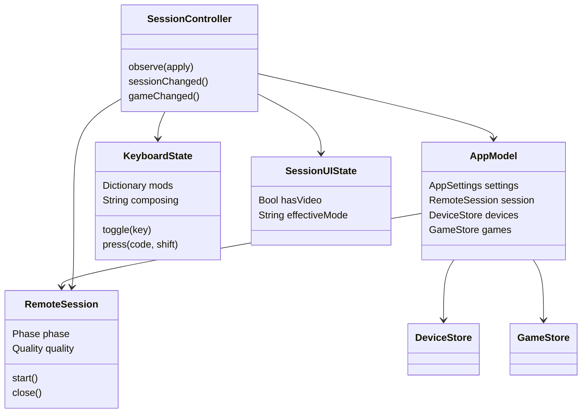
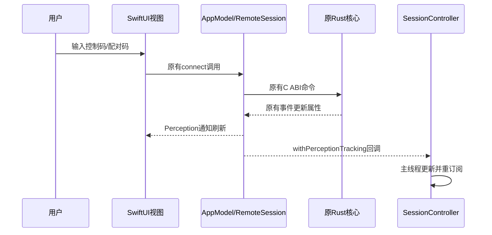
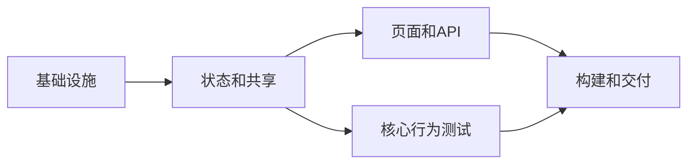

# iOS 16.6.1 兼容增量设计

基线 `08e2db0`；约束以 [验收标准](ios16-acceptance.zh-CN.md) 为准。该设计只改变 iOS 兼容层、测试接入和候选包构建，不改变网络协议、服务器信任、身份材料、文件格式和现有产品布局。

## 实现方式

维持 SwiftUI + UIKit + Rust C ABI 架构。统一最低部署目标为 `16.6`，继续用上游 Xcode 27.2 / Swift 6.4 编译。Rust 固定为本机已验证的 `1.93.0`，所有 Cargo 构建使用现有 lockfile 和 `--locked`。

状态观察统一使用 `swift-perception` 精确版本 `2.0.12`：真实 manifest 要求 Swift 6.4，最低 iOS 15 / macOS 12，与当前工具链和目标系统匹配。不得改用 `main` 或浮动版本。

1. 所有 `import Observation` 改为 `import Perception`；7 个 `@Observable` 改为 `@Perceptible`，`@ObservationIgnored` 改为 `@PerceptionIgnored`，6 个 `@Bindable` 改为限定名称 `@Perception.Bindable`，UIKit `withObservationTracking` 改为 `withPerceptionTracking`，保留现有主线程异步重订阅。
2. 访问可感知状态的各个视图 `body` 包裹 `WithPerceptionTracking`。同时审查逃逸的 ViewBuilder：`ForEach`、`GeometryReader`、sheet、导航目标、toolbar、contextMenu 等在实际读取状态的闭包内独立包裹；外层 body 包裹不能保证延迟执行闭包受到跟踪。纯值视图无需机械包裹。同步构建的 computed view / helper 可沿用调用方跟踪作用域。
3. 保留 `@State` 持有单例 AppModel 的写法。Perception 提供对应绑定，不迁移为 Combine，避免嵌套对象通知语义和持久化副作用变更。
4. 新版 `onChange` 改为 iOS16 单参数闭包；`.spring(duration:)` 改为 `response` / `dampingFraction` 等旧构造器，保持相近动画。麦克风权限在 iOS17+ 使用 `AVAudioApplication`、旧系统使用 `AVAudioSession.sharedInstance().requestRecordPermission`，两路均回到主队列。蓝牙 HFP 可使用旧名称 `.allowBluetooth` 维持同一选项值，避免依赖新 SDK 命名；不得因此删除蓝牙或麦克风能力。
5. 原样抽取 `Native.swift` 中 JSON / Json / Dictionary 工具、Clock 与 hex helper 到 `Shared/Utilities.swift`，只移动声明，不复制或改写实现。将 `KeyboardState` 和 `SessionUIState` 从 UIKit 大文件原样移入 `Session/SessionState.swift`，让真实生产状态可被宿主测试编译。

## 文件和依赖

| 模块 | 修改/新增文件 |
|---|---|
| 基础设施 | `ios/project.yml`、`ios/Package.swift`、`ios/Package.resolved`、`ios/.gitignore`、`ios/Airhand/App.swift` |
| 模型/共享 | `ios/Airhand/Core/{AppModel,ControllerClient,Devices}.swift`、`ios/Airhand/Controller/RemoteSession.swift`、`ios/Airhand/Session/{GameModel,SessionState}.swift`、`ios/Shared/{Native,Utilities}.swift` |
| 页面/API | `ios/Airhand/UI/{ConnectView,SettingsView,ShareView,Theme}.swift`、`ios/Airhand/Session/{SessionController,SessionViews,SessionMenu,GameEditor}.swift`、`ios/Airhand/Controller/Audio.swift` |
| 测试 | `ios/CoreTests/*.swift`、`ios/Tests/ObservationTests.swift`（可复用生产状态测试）、`ios/native/tests/ffi.rs` |
| 构建/闸口 | `.github/workflows/ios16.yml`、`ios/scripts/{build-rust.sh,build-ipa.sh,check-ios16.sh,verify-ipa.py}`、`ios/scripts/tests/test_verify_ipa.py` |
| 文档 | 本设计、`docs/ios16-acceptance.zh-CN.md`、`docs/ios.zh-CN.md`、`docs/ios.md` |

新增运行时依赖仅 `swift-perception@2.0.12`，仅主 App 链接 `Perception` 产品；广播扩展不需要它。测试目标若直接 import Perception，需显式链接产品。XcodeGen 的 `packages` 使用 exact version。纯逻辑 Package 和 Xcode 工程共享同一组锁定 pins：以提交的 `ios/Package.resolved` 为规范，在工程生成后复制到 `Airhand.xcodeproj/project.xcworkspace/xcshareddata/swiftpm/Package.resolved`；使用禁用自动升级/强制 resolved 选项，比较完整 pins（identity、revision、version），不比较与根图相关的 originHash。

## 核心数据关系与调用

图中的既有方法签名以源码为准；状态观察包装器改变通知机制，业务调用关系不改变。

## 本地可执行核心测试

`ios/Package.swift` 定义生产源码 allowlist 的 `AirhandCoreLogic` target：`Shared/Utilities.swift`、`Shared/Model.swift`、`Shared/L10n.swift`、`Airhand/Core/Protocol.swift`、`Airhand/Session/Gestures.swift`、`Airhand/Controller/AvSync.swift`、`Airhand/Session/SessionState.swift`。宿主 Package 最低 macOS14（匹配 CLT 自带 Testing.framework），使用 Swift 5 语言模式，与 Xcode 工程一致；不要为可移植测试编译整个 UIKit 应用或加入虚假的 Native / AppModel 实现。测试不导入 SharedStore，避免访问或改变用户真实 App Group/Library 数据。

测试直接使用这些生产源码并读取 `crates/airhand-link/tests/protocol.json`（通过源码位置定位仓库 fixture），覆盖协议样例、控制码/命令/输入合并及键释放顺序、无效/截断媒体头、手势 cancel 释放、音画同步 generation 与超时/延迟边界、JitterBuffer 初始缓冲、真实 KeyboardState/SessionUIState 的观察和重订阅。宿主测试使用 `AirhandCoreSelfTest` 可执行断言器和 `@testable import AirhandCoreLogic`；它不依赖本机缺失的 XCTest / Testing 互操作运行时，iOS Tests 保留 XCTest。不要把 iOS VideoToolbox/Opus 硬件调用在 macOS 上的替身结果称为真机通过。

Perception 2.0.12 未提供公开的“强制旧系统 backend”开关。在新 macOS 上运行会自动使用系统 Observation，因此本机测试只证明宏编译、生产状态语义和订阅生命周期；不声称已在 iOS16 运行。不要为测试 patch 依赖或引入生产开关。旧系统 backend 和所有 UI 延迟闭包覆盖仍由 G3 验收。

`ios/native/tests/ffi.rs` 使用公开 C ABI 做宿主测试：版本号、空/正确/错误指纹、非法 UTF8/JSON/配置、不存在的句柄与返回错误字符串释放。输入指针必须满足安全契约；不制造悬空指针、重复释放等 UB。host 成功不等价于 iOS 静态链接成功。

宿主测试显式使用 SwiftPM `native` 构建引擎，避免默认 swiftbuild 对宿主测试引入不必要的 bundle 签名；CI使用同一引擎。

本地统一 `check-ios16.sh`：运行锁定的 Rust proto/link/mobile/server 测试、iOS native 测试、Swift 测试、XcodeGen 生成/部署版本核对、shell/YAML/Actions 语法、IPA校验器单测、`git diff --check`、安全范围与敏感文件检查。报告真实计数和跳过项，不把“不执行”写为通过。生产源码改动若涉及媒体解析边界，补行为回归并保持协议不变。

## Actions 与 IPA 闸口

独立 `ios16.yml` 仅 `compat/ios-16.6` push 和 `workflow_dispatch`。声明 `contents: read`、超时、并发取消旧构建；不使用高权限 PR 事件、无 secrets、无 Release 或自动部署。`actions/checkout` / `actions/upload-artifact` 等动作固定经核验的提交 SHA 并注释对应版本，checkout `persist-credentials: false`。Rust 通过 runner 自带 rustup 安装固定 `1.93.0` 和设备/模拟器 target；XcodeGen 使用核验的官方固定版本及SHA256校验下载，或固定版本安装后显式核对；禁止静默使用最新工具。打印版本和源码 SHA。

设备 Release 编译复用 `build-ipa.sh`；Rust脚本最低16.6且 `cargo build --locked`。保持 signed 和 ad-hoc 两条既有路径，日志改为 `tee`，在 `set -o pipefail` 下保留失败退出码。不删除原有扩展或权限。包仍先签扩展后签主 App。

CI 先运行可移植Swift测试，再在已有新系统模拟器执行 `AirhandTests`；使用明确检测到的 simulator UUID 和 SDK runtime，不能假定runner存在iOS16。为模拟器增加Rust target；测试失败阻塞候选包上传。若无可用模拟器，按验收标准显式记录原因/替代结果，不伪造通过。最终设备构建和IPA校验必须成功。

`verify-ipa.py IPA` 只接受预期包结构，在临时目录安全解压并验证：

- 主 App 与唯一预期 Broadcast 扩展、Info.plist、CFBundleExecutable 实际存在，Bundle ID/广播标识一致，`MinimumOSVersion=16.6`。
- 对每个 Mach-O（不只扩展名）验证设备 iOS 平台、含arm64、没有模拟器平台、`minos <=16.6`；不得通过改 plist 掩盖过高二进制目标。发现无法解释的架构/平台/版本即失败。
- 验证 ad-hoc 签名与双方 entitlements；App Group 精确相同、原bundle标识匹配。允许的权限取最小 allowlist；禁止 `get-task-allow=true`、私有无沙盒/platform/debug/dynamic-code权限。
- 审查动态加载命令：iOS16没有的框架（尤其Observation）不得 `LC_LOAD_DYLIB` 强链接，允许新SDK的正确弱链接。不得把SDK版本高误判为最低系统高。
- 排除 profile、私钥、日志、测试fixture、临时文件。输出逐文件检查清单和最终IPA SHA256。测试校验器的通过/失败路径，至少包含错误minOS、模拟器平台、缺扩展和权限扩大。

IPA artifact 上传仅在所有必须步骤成功后执行；诊断日志/xcresult 可以 `always()` 单独上传。Summary 记录提交、工具版本、最低版本、架构、IPA SHA256，明确“候选包，G3未执行”。保留期有限，不上传运行用户设置。

## 有序实施任务

| ID | 优先级/依赖 | 任务和文件 |
|---|---|---|
| T01 | P0 / 无 | 项目基础设施：`project.yml`、`Package.swift`、`Package.resolved`、`.gitignore`、`App.swift`；固定部署目标/Perception/锁文件，建立纯逻辑target与入口兼容 |
| T02 | P0 / T01 | 状态模型和可测共享代码：AppModel、ControllerClient、Devices、RemoteSession、GameModel、SessionState、Native、Utilities；按上述规则迁移/原样抽取 |
| T03 | P0 / T02 | 所有页面/延迟闭包与API回退：UI四文件、SessionController/Views/Menu/GameEditor、Audio；逐处检查真实状态读取作用域 |
| T04 | P0 / T02 | 核心与安全行为验证：CoreTests、ObservationTests、native/tests/ffi.rs、verify-ipa校验器单测；无stubs、不碰用户真实数据 |
| T05 | P0 / T03,T04 | 构建交付闸口：check-ios16.sh、build-rust.sh、build-ipa.sh、verify-ipa.py、ios16.yml、中英文构建文档；G1通过并独立QA后才允许推送个人分支 |

## 共享约定与限制

Bundle ID `app.airhand.ios`、扩展 `app.airhand.ios.broadcast`、App Group `group.app.airhand.ios`、持久化键和C ABI均保持。服务器变量可空；无效指纹仍拒绝，不借兼容修改绕过信任。CI构建不要求Apple账号。工程师完成后输出全局一致性 `IS_PASS`；QA独立检查观察范围、锁定依赖、日志失败传播和校验器拒绝路径。G1通过只授权推个人兼容分支，G2后才交付候选IPA，G3需要用户设备且仍待执行。

参考：Perception [2.0.12 manifest](https://github.com/pointfreeco/swift-perception/blob/2.0.12/Package.swift)、[Registrar的版本分派](https://github.com/pointfreeco/swift-perception/blob/2.0.12/Sources/PerceptionCore/Perception/PerceptionRegistrar.swift)、[延迟闭包检查说明](https://github.com/pointfreeco/swift-perception/blob/2.0.12/Sources/PerceptionCore/Perception/PerceptionRegistrar.swift)。

## 宿主执行器补充

本机 CLT 缺少完整测试框架运行时，宿主核心验证使用 `swift run --package-path ios --build-system native --force-resolved-versions AirhandCoreSelfTest`。显式登记并执行22项原用例，所有期望表达式保持，断言失败累积并返回非零；G1另运行故意失败探针证明执行器不会吞掉失败。只编译生产源码allowlist，不复制生产实现或访问用户持久数据。iOS工程的XCTest继续由CI执行。

## 工程师全局一致性收尾

IS_PASS: YES。复核对象为 `/private/tmp/airhand-ios16-validated-source` 最终验证工作树。Swift Package 可执行目标、G1与CI的 `swift run ... AirhandCoreSelfTest` 调用一致；22个用例声明与注册一一对应，88个期望表达式与此前框架版逐项保持，未知媒体类型仍明确失败，故意失败探针退出1。完整G1证据为277项Rust核心/服务器、4项C ABI、22项生产Swift核心、7项IPA校验器，共310项通过；格式与安全边界复核无遗留阻塞。

G2尚未执行设备Release编译与真实IPA检查；G3尚未执行用户iOS16.6.1 + TrollStore安装和交互验收。宿主新系统上的Perception观察通过不替代旧系统backend验证。提交前必须使用这一已验证源码快照；若回同步到本地codes目录或其他工作树，应逐文件核对，不能将原先尚未更新的Swift Testing版本作为本次通过对象。
